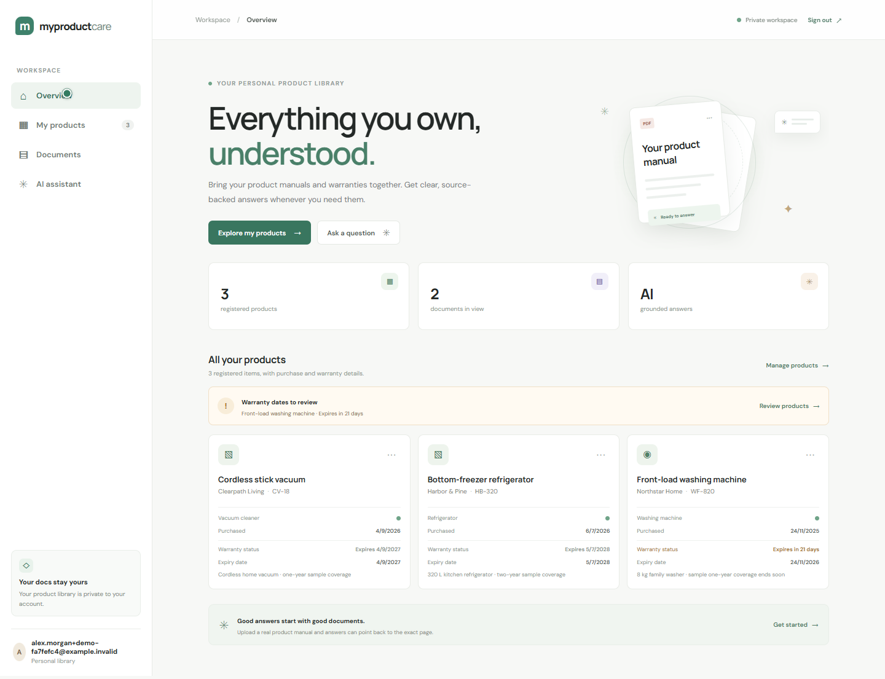

# MyProductCare

MyProductCare is a product-document assistant. Register a product, upload its manual or warranty document, then ask questions grounded in those files with page-aware citations.

## Demo



[Watch the full product-warranty demo on Google Drive](https://drive.google.com/file/d/1wcLFDY1zZd1e-GFpDIX4mcVVMkUnLVU6/view?usp=sharing). The locally recorded walkthrough is also saved as `demo-output\myproductcare-product-warranty-demo.webm`; generated video files are intentionally ignored by Git.

## What works

- FastAPI backend and Angular frontend.
- Product CRUD and per-token user isolation.
- Warranty expiry dates with upcoming/expired status and user-confirmed date suggestions from warranty documents.
- PDF (text PDFs), TXT, and Markdown ingestion with page metadata.
- BGE-small embeddings stored in local persistent Qdrant.
- BM25 keyword search + vector search combined with reciprocal rank fusion.
- BGE cross-encoder reranking and product-scoped retrieval.
- OpenAI-backed answers constrained to retrieved passages, with a safe insufficient-evidence response.
- Conversation persistence and source passages.
- Document/product deletion also removes associated vectors.
- API docs at `http://127.0.0.1:8000/docs`.

The sample washer manual (`sample_data\northstar_home_wf820_washer_manual.txt`) and warranty fixture are fictional and provided only to demonstrate the local flow. They are not manufacturer guidance. Add a real product manual and its warranty conditions before relying on answers about a real appliance. This MVP does not approve warranty claims or replace professional service.

## Requirements

- Python 3.11+
- Node.js 22+
- Internet access on first ingestion/chat to download the BGE embedding and reranker models (unless cached)
- A Google Gemini or OpenAI API key for generated answers. Gemini may offer a free API tier subject to current model, account, regional, and rate limits. Without a configured provider key, the app returns relevant source excerpts instead.

## Run locally (Windows PowerShell)

```powershell
py -3.11 -m venv .venv
.\.venv\Scripts\Activate.ps1
python -m pip install -r backend\requirements.txt
cd frontend
npm ci
cd ..
```

For Gemini, create an API key in [Google AI Studio](https://aistudio.google.com/apikey), then add it to your local `.env`. If there is no OpenAI key and no explicit `LLM_PROVIDER`, the backend automatically selects Gemini:

```powershell
Copy-Item .env.example .env
# Edit .env and set GEMINI_API_KEY to your private key.
```

Users create an account with an email and password in the app. Passwords are stored as Argon2 hashes; the backend issues revocable bearer sessions that expire after 30 days. Gemini/OpenAI credentials stay in the backend `.env` and are never entered as a user password. Keep `.env` private, never commit it, and restart FastAPI after changing provider settings.

On an existing local installation, the first account can keep access to the prior library if the old `APP_API_TOKEN` is still present in `.env` during that first registration. After confirming the account can see its products, the obsolete `APP_API_TOKEN` line can be removed. Later accounts receive separate product/document/conversation ownership.

Start the backend in one terminal and the Angular app in another:

```powershell
python -m uvicorn backend.app.main:app --reload
```

```powershell
cd frontend
npm start
```

Open `http://localhost:4200` and create an account or sign in. Data is stored locally under `data\`; do not commit it.

The assistant reports **source-only mode** when the selected answer-generation provider has no API key. In that mode it can retrieve matching passages and show citations but does not generate an AI summary. Put a valid provider key in the root `.env` and restart FastAPI to enable summaries. Do not commit or share the key.

To record a local browser walkthrough after starting both apps, run `npm run record:demo` from `frontend\`. The script requires Microsoft Edge and uses a throwaway account with fictional sample data:

- A Northstar Home WF-820 front-load washer, purchased about 11 months ago, with a sample one-year warranty expiring in 21 days.
- A Harbor & Pine bottom-freezer refrigerator with a two-year sample warranty.
- A Clearpath Living cordless vacuum with a one-year sample warranty.

The walkthrough reviews the full product dashboard and uses the app's actual **Choose file** control to upload local files from `sample_data\`: the fictional washer manual and a generated sample warranty. It does not draw a fake file dialog. Playwright selects those files from disk through the browser's file input; because the video records the browser page, it cannot show the Windows file-picker window. In normal interactive use, **Choose file** opens the standard Windows file picker. The date selection is shown separately as a recording-only in-page preview because the native date picker is also outside the browser recording. The dates are saved to the product normally. The walkthrough then asks practical questions about a 4C water-fill error and safe detergent-drawer care before returning to the dashboard. The questions are intended to show source-grounded answers and citations, not to give guidance for a real appliance. All sample brands, models, serial/receipt references, coverage terms, and dates are invented.

The generated video stays in the ignored `demo-output\` folder as `myproductcare-product-warranty-demo.webm`. A dashboard preview is saved as `docs\product-warranty-demo-dashboard.png`. The recorder script and generated videos are intentionally kept local; neither is included in Git.

## Docker

Set an answer-generation provider key (for example `GEMINI_API_KEY`) in your environment, then run:

```powershell
docker compose up --build
```

Open the frontend at `http://localhost:4200`.

## API overview

Registration, login, and health are public. Other data routes require the bearer session returned by login.

| Method | Route | Purpose |
|---|---|---|
| POST | `/api/auth/register` | Create an account and start a session |
| POST | `/api/auth/login` | Sign in and start a session |
| GET | `/api/auth/me` | Read the signed-in account |
| POST | `/api/auth/logout` | Revoke the current session |
| POST / GET | `/api/products` | Create/list products |
| GET / PUT / DELETE | `/api/products/{id}` | View/update/delete an owned product |
| POST / GET | `/api/products/{id}/documents` | Upload/list product documents |
| DELETE | `/api/documents/{id}` | Delete a document and its Qdrant vectors |
| POST | `/api/chat` | Ask a product-specific question |
| POST | `/api/chat/new?product_id=...` | Start a conversation |
| GET | `/api/chat/history/{id}` | Read conversation messages and citations |

Interactive OpenAPI documentation is available at `/docs`.

## Tests

```powershell
python -m pytest backend\tests -q
```

Tests cover account registration/login/logout, per-account product isolation, legacy library ownership, warranty tracking, text cleanup, page-aware chunking, query classification, and reciprocal-rank fusion. Retrieval-quality evaluation on real manufacturer manuals and a 50-question ground-truth set is not included yet; no performance results are claimed.

## Current scope and limitations

- Email verification and automated login rate limiting are not included. Use HTTPS and an edge/server rate limit before exposing the API beyond a trusted local network.
- Warranty assessment is not implemented; the assistant only answers from uploaded evidence.
- Warranty expiry suggestions are based on simple text patterns, not authoritative interpretation; users must review and save a date. The app does not send background or email notifications.
- The evaluation harness, real-manual benchmark corpus, and measured baseline-vs-advanced results remain future work.
- Scanned/image-only PDFs need OCR, which is not included.
- Recent conversation turns are passed to answer generation and recent user questions are included when retrieving context for follow-up questions.
- This is an MVP. Do not use it as the sole basis for safety or warranty decisions.
