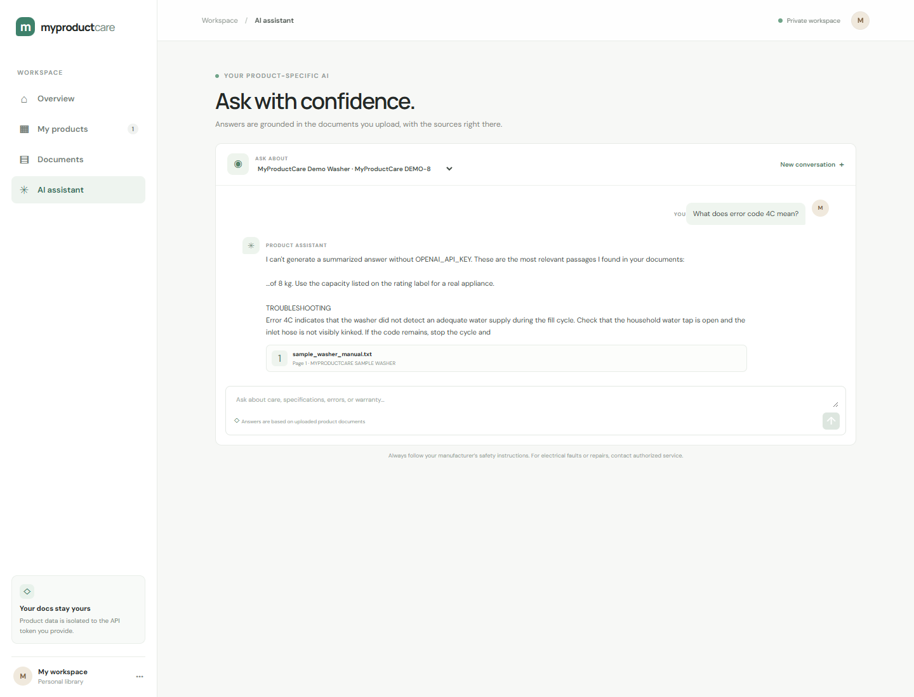

# MyProductCare

MyProductCare is a product-document assistant. Register a product, upload its manual or warranty document, then ask questions grounded in those files with page-aware citations.

## Demo



[Watch the browser demo (WebM)](https://github.com/GaneshN29/MyProductCare/releases/latest/download/myproductcare-demo.webm). The walkthrough uses the clearly labeled fictional sample manual.

## What works

- FastAPI backend and Angular frontend.
- Product CRUD and per-token user isolation.
- PDF (text PDFs), TXT, and Markdown ingestion with page metadata.
- BGE-small embeddings stored in local persistent Qdrant.
- BM25 keyword search + vector search combined with reciprocal rank fusion.
- BGE cross-encoder reranking and product-scoped retrieval.
- OpenAI-backed answers constrained to retrieved passages, with a safe insufficient-evidence response.
- Conversation persistence and source passages.
- Document/product deletion also removes associated vectors.
- API docs at `http://127.0.0.1:8000/docs`.

The sample washer manual is fictional and provided only to try the local flow. It is not manufacturer guidance. Add a real product manual and its warranty conditions before relying on answers about a real appliance. This MVP does not approve warranty claims or replace professional service.

## Requirements

- Python 3.11+
- Node.js 22+
- Internet access on first ingestion/chat to download the BGE embedding and reranker models (unless cached)
- An OpenAI API key for generated answers. Without one, the app clearly returns relevant source excerpts instead.

## Run locally (Windows PowerShell)

```powershell
py -3.11 -m venv .venv
.\.venv\Scripts\Activate.ps1
python -m pip install -r backend\requirements.txt
cd frontend
npm ci
cd ..
```

Create a local token (also used by the demo recorder). Add your OpenAI key to `.env` if you want generated summaries; without it, retrieval and citations still work:

```powershell
$env:APP_API_TOKEN = [guid]::NewGuid().ToString() + [guid]::NewGuid().ToString()
"APP_API_TOKEN=$env:APP_API_TOKEN" | Set-Content .env
Add-Content .env 'OPENAI_API_KEY=your-key'
```

Start the backend in one terminal and the Angular app in another:

```powershell
python -m uvicorn backend.app.main:app --reload
```

```powershell
cd frontend
npm start
```

Open `http://localhost:4200` and paste the same `APP_API_TOKEN` into the connection screen. Data is stored locally under `data\`; do not commit it.

To record a real browser walkthrough after starting both apps, run `npm run test:demo` from `frontend\`. The script requires Microsoft Edge and uses the running API to register the fictional sample washer, upload its sample text manual, and ask a cited question. It writes the video under the ignored `demo-output\` directory and a preview to `docs\demo-screenshot.png`. The sample manual is not advice for a real appliance.

## Docker

Set `APP_API_TOKEN` and optionally `OPENAI_API_KEY` in your environment, then run:

```powershell
docker compose up --build
```

Open the frontend at `http://localhost:4200`.

## API overview

All routes other than `/api/health` require `Authorization: Bearer <APP_API_TOKEN>`.

| Method | Route | Purpose |
|---|---|---|
| POST / GET | `/api/products` | Create/list products |
| GET / PUT / DELETE | `/api/products/{id}` | View/update/delete an owned product |
| POST / GET | `/api/products/{id}/documents` | Upload/list product documents |
| DELETE | `/api/documents/{id}` | Delete a document and its Qdrant vectors |
| POST | `/api/chat` | Ask a product-specific question |
| POST | `/api/chat/new?product_id=...` | Start a conversation |
| GET | `/api/chat/history/{id}` | Read conversation messages and citations |

Interactive OpenAPI documentation is available at `/docs`.

## Tests

```powershell
python -m pytest backend\tests -q
```

Tests cover text cleanup, page-aware chunking, query classification, and reciprocal-rank fusion. Retrieval-quality evaluation on real manufacturer manuals and a 50-question ground-truth set is not included yet; no performance results are claimed.

## Current scope and limitations

- Authentication is a single shared bearer token per local deployment; it provides separate data ownership by token but is not a multi-account registration/login system.
- Warranty assessment is not implemented; the assistant only answers from uploaded evidence.
- The evaluation harness, real-manual benchmark corpus, and measured baseline-vs-advanced results remain future work.
- Scanned/image-only PDFs need OCR, which is not included.
- Recent conversation turns are passed to answer generation and recent user questions are included when retrieving context for follow-up questions.
- This is an MVP. Do not use it as the sole basis for safety or warranty decisions.
